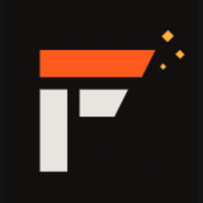

<p align="center"></p>

# Forge

**AI destekli, Rust ile yazılmış, hafif ve hızlı oyun motoru & editör.**
*An AI-native game engine and editor written in Rust: a lean, Unity-style workflow with an agent team that builds scenes for you.*

| | |
|---|---|
| **Editör** | Hierarchy · GPU Scene/Game görünümü (OpenGL) · Inspector · Console · Script editörü · Gizmo · Undo/Redo |
| **Forge AI (sağ panel)** | Çok ajanlı mimari: Router → Planner → Builder ⇄ sahne araçları → Coder → Reviewer |
| **Modeller** | **Auto (`openrouter/free`)**, Gemma 4 31B, Mercury Decide, North Mini Code, Inkling Small (+ istediğin OpenRouter modeli) |
| **Kütüphane (sol panel)** | Hugging Face'te GGUF ara/indir (devam ettirilebilir), llama.cpp çalışma zamanını tek tıkla kur, yerel model başlat, Ollama |
| **Oyun** | Rhai betikleri, AABB fizik, takip kamerası, HUD, ▶ Play / ⏸ / ■ Stop, **Build Game** (tek başına çalışan oyun) |
| **Kurulum** | Windows `Forge-Setup.exe` (NSIS sihirbazı) + uygulama içi ilk açılış sihirbazı |

## Kurulum

### Windows
`Forge-Setup-<sürüm>.exe` dosyasını çalıştır. Sihirbaz dil seçimi, lisans, bileşenler (Başlat menüsü / masaüstü kısayolu) ve isteğe bağlı **OpenRouter API anahtarı** adımlarından geçer. Anahtar yalnızca `%APPDATA%\Forge\.env` dosyasına yazılır.

### Linux / macOS
```sh
cargo build --release
./installer/install.sh        # ~/.local/bin/forge + masaüstü girdisi
```

İlk açılışta **Kurulum Sihirbazı** açılır: OpenRouter anahtarı (test butonuyla), varsayılan model, yerel AI (llama.cpp + başlangıç modeli) ve ilk proje/şablon.

## API anahtarları

Forge anahtarları şu sırayla arar (ilk bulunan kazanır):

1. Ortam değişkenleri (`OPENROUTER_API_KEY`, `HF_TOKEN`)
2. `Forge.exe` yanındaki `.env` veya `Forge.env/.env`
3. Çalışma dizinindeki `.env`
4. Kullanıcı veri klasöründeki `.env` (`%APPDATA%\Forge`, `~/.local/share/Forge`, `~/Library/Application Support/Forge`)

Takımın anahtarları özel **`Forge.env`** deposunda tutulur; o depoyu `Forge.exe`'nin yanına klonlamak yeterli. Bu repoya hiçbir zaman anahtar commit edilmez (`.env` gitignore'da).

## Forge AI ajanları

```
 kullanıcı ─► Router ─┬─ sohbet ───────────────► Forge AI ─► cevap
                      └─ inşa ─► Planner ─► Builder ⇄ araçlar (sahne)
                                              │  └─ ask_coder ─► Coder ─► set_script (derlenerek doğrulanır)
                                              ▼
                                           Reviewer ─► (düzeltmeler → Builder)
```

* **Router**: hızlı sezgisel yönlendirme; Ayarlar'dan bir LLM (örn. *Mercury Decide*) atanabilir.
* **Builder** sahneyi yalnızca araçlarla düzenler: `create_entity`, `create_many`, `update_entity`, `delete_entity`, `duplicate_entity`, `set_script`, `ask_coder`, `add_camera`, `set_environment`, `clear_scene`, `select`, `get_scene`.
* Araç çağrıları model bağımsız bir metin protokolüyle yapılır (```` ```tool {json} ``` ````), bu sayede function-calling desteklemeyen ücretsiz ve yerel modeller de çalışır.
* Her ajana ayrı model atanabilir (AI ▸ Settings). Seçilen model hata verirse otomatik olarak **Auto**'ya düşülür.
* Tüm ajan çalışması tek bir **Undo** adımıdır.

## Betik (Rhai)

```rust
fn start() { this.speed = 6.0; }
fn update(dt) {
    if key("A") { this.x -= this.speed * dt; }
    if key("D") { this.x += this.speed * dt; }
    if key_pressed("SPACE") && this.grounded { this.vy = 8.0; }
    let n = destroy_touching(this.name, "Coin");
    if n > 0 { set_global("score", get_global("score") + n); }
    hud("Skor: " + get_global("score"));
}
```
Tam referans: *Help ▸ Scripting reference*.

## Yerel modeller

*Library ▸ Local ▸ Install runtime* resmi llama.cpp sürümünü indirir (Windows/Linux: Vulkan GPU, macOS: Metal). *Library ▸ HF Hub* üzerinden GGUF ara, `Q4_K_M` önerilen nicemlemedir. *Use* modeli `llama-server` ile `127.0.0.1:8089` üzerinde başlatır, sohbet modeli otomatik olarak ona geçer. Ollama çalışıyorsa modelleri de listelenir.

## Geliştirme

```sh
cargo run              # editör
cargo test             # araç ayrıştırıcı, sahne araçları, fizik/betik, uçtan uca ajan testi (sahte LLM)
cargo build --release --target x86_64-pc-windows-gnu && makensis installer/forge.nsi   # Windows kurulum dosyası
forge --play oyun.scene.json   # oyuncu modu
```

Yapı: `src/app.rs` editör · `src/render.rs` OpenGL renderer · `src/runtime.rs` Play modu (Rhai + fizik) · `src/ai/` ajanlar, istemci, araçlar, modeller · `src/library.rs` HF/llama.cpp/Ollama · `src/wizard.rs` kurulum sihirbazı.
