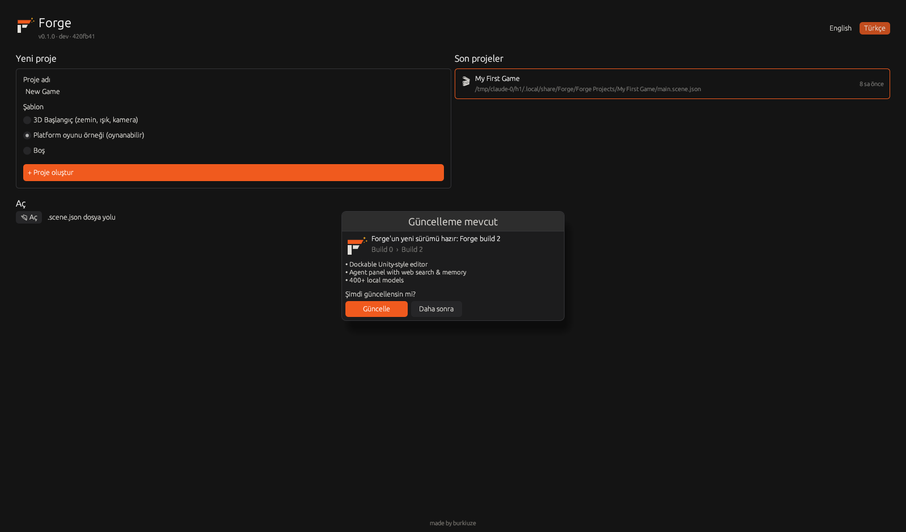
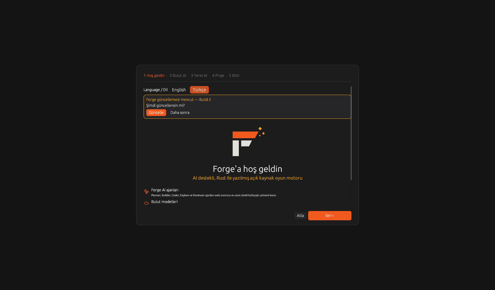
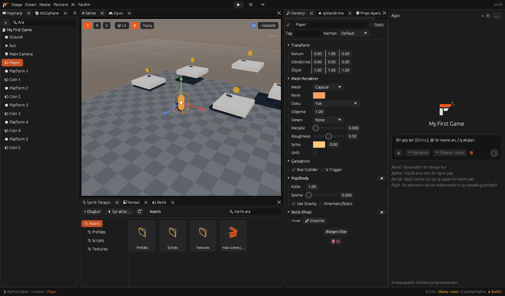
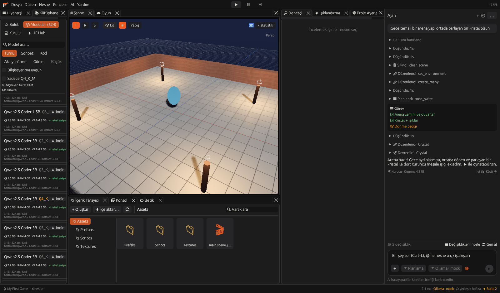
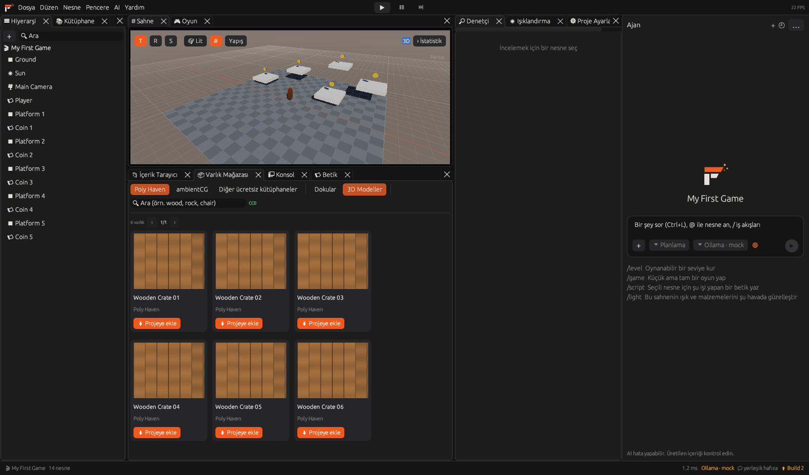
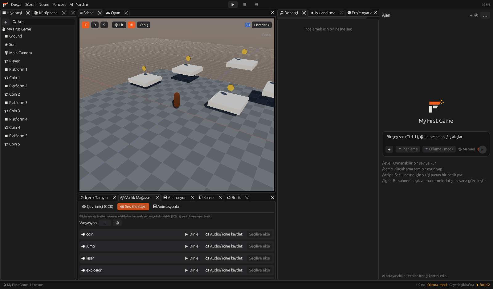
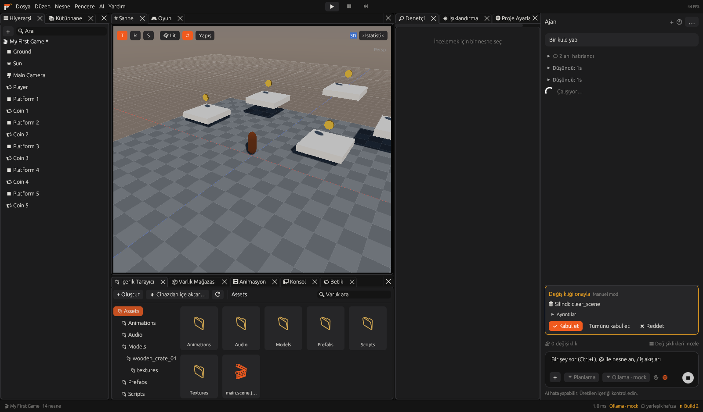
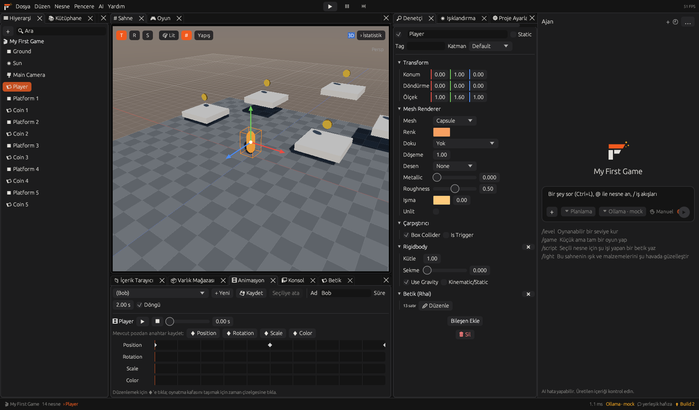
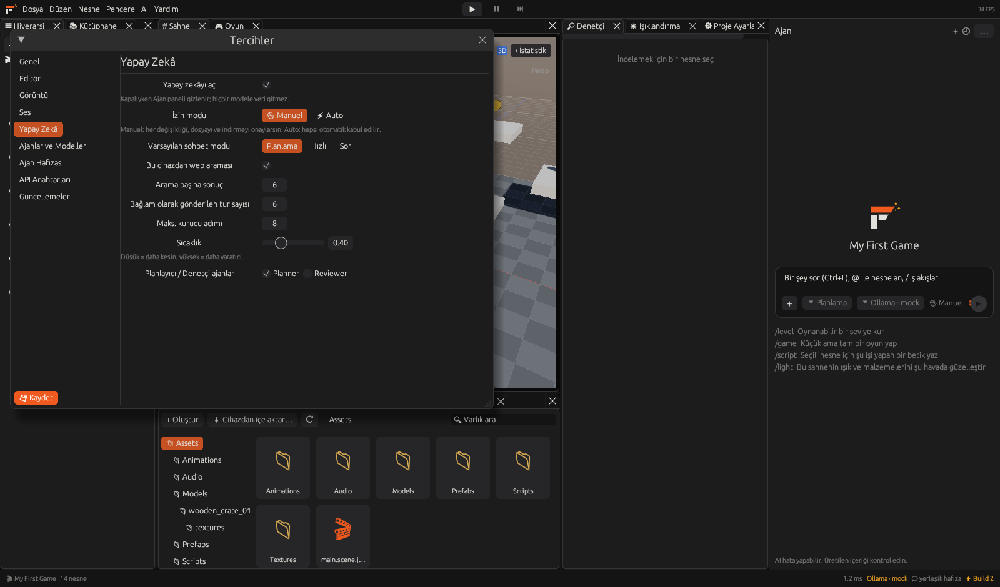

<p align="center"></p>

# Forge

**Rust ile yazılmış, açık kaynak ve AI destekli oyun motoru ve editörü.**
*Open-source, AI-native game engine & editor written in Rust: a Unity/Unreal-style workflow with an agent team that builds your game.*


| Açılış ekranı + güncelleme sorusu | Kurulum sihirbazı (EN/TR) |
|---|---|
|  |  |
| **Inspector + gizmo** | **Yerel model kataloğu** |
|  |  |
| **Varlık Mağazası (CC0)** | **Ses efektleri** |
|  |  |
| **Manuel izin: Kabul / Reddet** | **Animasyon sekmesi** |
|  |  |
| **Tercihler** | |
|  | |

## Özellikler

**Editör (dock'lu, sürükle-bırak sekmeler)**
- Scene / Game görünümleri, Hierarchy (sürükle-bırak ile ebeveyn), Inspector, Lighting, Project Settings, Content Browser, Console, Script
- Taşı / Döndür / Ölçekle gizmoları (W/E/R), yapışma (snap), Lit / Unlit / Wireframe, ızgara, Stats katmanı
- OpenGL renderer: gerçek zamanlı gölge (shadow map + PCF), 8 noktasal ışık, metalik/pürüzlülük/ışıma malzemeleri, doku + döşeme, prosedürel desenler, gökyüzü, sis, pozlama
- Prefab'lar, prosedürel başlangıç dokuları, içe aktarma, oyunu tek başına derleme (Build Game)
- Play / Pause / Step: Rhai betikleri, AABB fizik, takip kamerası, HUD
- İngilizce / Türkçe arayüz
- 🔊 **Ses**: Audio Source bileşeni (döngü, ses düzeyi, başlangıçta çal), `play_sound()` betik fonksiyonu, 8 hazır efekt üreteci (coin, jump, laser, explosion…) ile WAV oluşturma
- 🎞 **Animasyon**: Animation sekmesi (anahtar kare kaydı, zaman çizelgesi, önizleme), Animator bileşeni, `.anim.json` klipleri ve hazır klipler (bob, spin, walk, door…)
- ⬇ **Cihazdan içe aktarma**: dosya seçici veya pencereye sürükle-bırak (model, doku, ses, betik)
- ⚙ **Tercihler**: Genel, Editör, Görüntü, Ses, AI, Ajanlar ve Modeller, Hafıza, Anahtarlar, Güncellemeler. AI tamamen kapatılabilir.

**Ajan paneli (Antigravity tarzı, sağda)**
- Modlar: **Planning** (Planner → Builder → Reviewer), **Fast** (doğrudan Builder), **Ask** (salt-okunur)
- opencode'dan esinlenen mimari: birincil ajanlar + `task` alt-ajanları (**Explore** salt-okunur araştırma, **Coder** betik yazımı), **izin modları: ✋ Manual** (her değişiklik, varlık indirme ve kurulum için Kabul / Reddet kartı) ve **⚡ Auto** (otomatik kabul), `todo_write` görev listesi, uzun sohbetlerde özetleme (compaction), sohbet geçmişi
- 🌐 **Web araması cihazdan**: DuckDuckGo, gerekirse Bing; ayrıca `fetch_url` ile sayfa okuma. API anahtarı gerekmez.
- 💭 **Ajan hafızası**: [TencentDB Agent Memory](https://github.com/TencentCloud/TencentDB-Agent-Memory). Memory Core (`:8420`) ile `/v3/conversation/add` (yazma) ve `/v3/atomic/search` (hatırlama) kullanılır. Bağlantı yoksa yerleşik çevrimdışı BM25 hafızası devreye girer.
- "Düşündü: Xs" adımları, araç satırları, kaynak bağlantıları, İyi/Kötü geri bildirimi, "N değişiklik · İncele · Geri al" çubuğu
- `@` ile nesne anma, `/level /game /script /light /fix /explain /search` iş akışları

**Varlık Mağazası: ücretsiz CC0 varlıklar**
- **Poly Haven**: dokular ve glTF 3D modeller. **ambientCG**: 2000+ PBR malzeme. Arama, küçük resimler, tek tıkla projeye indirme, "Seçiliye uygula" ve "Sahneye koy".
- glTF/GLB model desteği: gerçek boyutta, dokulu, gölgeli. İçerik Tarayıcı'dan çift tıkla veya sahneye sürükle.
- **Önce varlık**: ajan karakter, araç ve eşyaları primitiflerden yapmaz. Projedeki varlıkları `list_assets` / `inspect_asset` ile inceler, yoksa `asset_search` / `asset_import` ile indirip kullanır.
- Ajan da kullanabilir: `asset_search` / `asset_import` ("zemine ahşap doku bul ve uygula", "sahneye bir sandık koy").
- Kenney, Quaternius, Poly Pizza, OpenGameArt, itch.io ve Freesound bağlantıları (bunların API'si yok; indirdiğin paketi İçe aktar ile eklersin).

**Modeller**
- Bulut (OpenRouter, ücretsiz): **Auto**, Gemma 4 31B, Mercury Decide, North Mini Code, Inkling Small, ayrıca istediğin model kimliği
- **Yerel katalog: 624 GGUF varyantı** (Llama, Qwen 2.5/3, Gemma 2/3/3n, Phi, Mistral, DeepSeek, gpt-oss, Granite…). Her varyant için disk boyutu, RAM ve VRAM gereksinimi ile "bilgisayarına uygun mu" göstergesi var. Tek tıkla indirilir; indirme yarıda kalırsa devam eder, bölünmüş dosyalar desteklenir.
- llama.cpp çalışma zamanı tek tıkla kurulur (Vulkan / Metal), Ollama desteklenir

**Otomatik güncelleme**
`main` dalına her push'ta CI Windows, Linux ve macOS için derler ve `build-N` adlı bir GitHub Release yayımlar. Forge açılışta bunu kontrol eder ve **"Şimdi güncellensin mi?"** diye sorar:
- Kurulu Windows sürümünde yeni Setup sessiz modda çalışır ve Forge yeniden açılır.
- Portable, Linux ve macOS sürümleri kendi dosyasını yeniler.

## Kurulum

- **Windows:** [Releases](https://github.com/burkiuze/Forge/releases/latest) sayfasından `Forge-Setup.exe` veya `Forge-portable.exe` indir.
- **Linux / macOS:** `tar.gz` içindeki `forge` dosyasını çalıştır ya da `cargo build --release && ./installer/install.sh` kullan.

API anahtarları şu sırayla aranır: ortam değişkenleri → `Forge.exe` yanındaki `.env` veya `Forge.env/.env` → çalışma klasörü → kullanıcı veri klasöründeki `.env` (`%APPDATA%\Forge`). Anahtarlar bu repoya asla commit edilmez.

## Geliştirme

```sh
cargo run                 # editör
cargo test                # 14 test: araçlar, fizik/betik, uçtan uca ajanlar (sahte LLM), web ayrıştırıcı, hafıza, sandbox, glif kontrolü
cargo build --release --target x86_64-pc-windows-gnu && (cd installer && makensis forge.nsi)
forge --play game.scene.json
```

Dizin yapısı:

| Dizin | İçerik |
|---|---|
| `src/app/` | Editör: dock, paneller, viewport + gizmolar, içerik tarayıcı |
| `src/chat.rs` | Ajan paneli |
| `src/ai/` | Ajanlar, araçlar, web, hafıza, istemci, modeller |
| `src/render.rs` | Renderer |
| `src/runtime.rs` | Play modu |
| `src/catalog.rs` | Model kataloğu |
| `src/library.rs` | Hugging Face, llama.cpp, Ollama |
| `src/updater.rs` | Otomatik güncelleme |
| `src/start.rs` | Açılış ekranı |
| `src/wizard.rs` | Kurulum sihirbazı |
